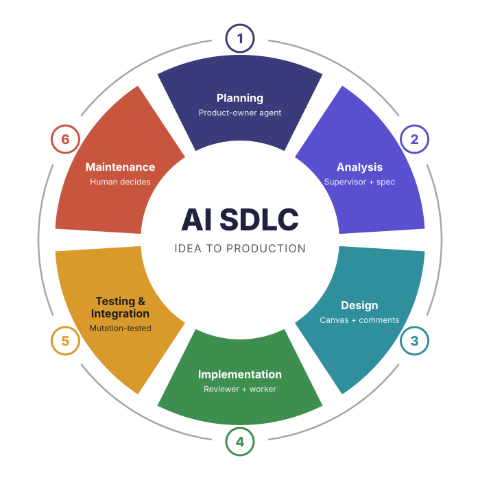

# The AI software development cycle: how I take a feature from idea to production

*October 2026.*



The software development cycle has six stages, and every one of them is still needed now that we build with agents: planning, analysis, design, implementation, testing and integration, maintenance. What has changed is who does the work at each stage, and where the human stands.

I build a consumer app on my own. Last week I took one feature around the whole cycle. Getting from idea to a finished specification took about five hours. The build ran overnight and produced a pull request with all 39 tasks done, and the feature went live the next day. The test suite grew from 1,419 tests to 1,532 with nothing broken. I wrote very little of the code myself.

Here is the cycle stage by stage, so you can run it on your own product. For each stage: what the stage is for, what the agents did, where I was the gate, and the rule I'd keep.

---

## 1. Planning: an agent playing product owner

**What the stage is for.** Working out what to build and why, before anyone works out how.

**What the agents did.** First, I cleaned the desk. I had the agent check which old sessions and branches were still needed and archive the rest. Agents read whatever is lying around, and stale work is the wrong context.

Then I gave the agent a job title, not a task. My opening message was rough:

> "I want you to become product owner for upcoming feature we want to build..."

followed by a line naming the specialist expertise I wanted it to bring, the way you would brief a senior hire.

The role changed what came back. I didn't get a feature list. I got a brief that graded every claim it relied on as established, moderate or preliminary, listed phrases the product must never print, and said where its own sources were thin.

Then I pushed it outward, asking it to learn from a well-known competitor and innovate beyond it. The agent studied that competitor and noticed something structural. That app sees one kind of data, and mine sees several, so its new ideas all came from that gap.

**Where I was the gate.** I decided which ideas were worth taking forward.

**Rule.** Name the expertise you want, ask for graded confidence, and ask what you can do that competitors structurally cannot.

---

## 2. Analysis: challenge the brief, then specify it

**What the stage is for.** Turning a wish list into requirements that are true, feasible and consistent.

**What the agents did.** This is where a second agent paid for itself. The agent that wrote the brief shares its own blind spots, so I said: "get this reviewed with your supervisor agent which is opus 5.5 as a subagent". The supervisor was a stronger model, ran read-only, and read the brief alongside the actual code.

Its verdict was **rework**. The biggest finding: about a third of the ideas depended on data the app doesn't record. The product-owner agent had assumed that data existed, and so had I. The supervisor checked the code and showed it wasn't there. Building those ideas would have meant showing users facts that were never captured.

It also found a safety check that one entry point could bypass, content that had drifted from information into advice, and features that could harm a vulnerable user. It cut the scope down to a smaller first version, with the rest behind a separate piece of foundation work. That cut most of what I had asked for an hour earlier. It was right.

Next came the decision every analysis needs and most skip: where does the feature live in the product? Where does setup go, where does daily use go, does it get a place in the navigation? We answered in plain words. We reused existing places and added no new top-level destination.

Finally the agent wrote the formal specification with Spec Kit: user stories, functional requirements and success criteria. Each one was checked against my project's constitution, a short list of principles the product must never break.

**Where I was the gate.** I accepted the scope cut and made the integration call.

**Rule.** Review requirements before design, with a different agent on a stronger model that can see the real system. A reviewer that only reads the document can't see what the code contradicts.

---

## 3. Design: a canvas reviewed through comments

**What the stage is for.** Deciding how it looks, how it behaves and how it's built.

**What the agents did.** I learned this stage by getting it wrong. The first time, I sent the brief to a design agent before we had decided where the feature lived. It came back with 19 polished artboards that looked nothing like my app, with its own header, its own navigation and its own components. What I saw "does not fit".

Once the integration was decided, the design agent redid every board. This time it started from the app's real component source and from earlier canvases that already reproduced the app. It drew 23 artboards inside the real shell, plus a list of what still didn't match.

I reviewed them the way I'd review a designer's file, with comments pinned to elements:

- "can this be different prominent"
- "button color"
- "need different wheel"
- "did not like the border"

Each comment was fixed live and answered in its own thread. When a fix missed, I said so in the same thread ("is this indicating progress? I dont think so"), and the next version got it right. That was nine threads in about twelve minutes.

Technical design came next: Spec Kit's plan stage produced the data model, the interface contracts and the research decisions. Where a principle in the constitution needed interpreting, the plan wrote the call down as a judgement, so a reviewer could disagree with it openly instead of finding it later.

**Where I was the gate.** No thread was closed until I was satisfied.

**Rule.** Ground the design agent in your real product, review with comments attached to the thing itself, and settle integration before the screens.

---

## 4. Implementation: a strong reviewer and a cheaper worker

**What the stage is for.** Building it.

**What the agents did.** Spec Kit's last stage turned the plan into 39 ordered tasks. I gave one instruction for them: they had to be good enough for another coding agent to build on a fresh branch "without causing any regression".

The task list also carried my scars. Every mistake that has cost me a session before became an explicit instruction:

- Record the passing test count before touching anything, and finish with nothing that passed before now failing.
- Never test against real user data.
- Mutation-test every guard.
- Avoid a specific tooling trap that has silently broken tests in this repo before.
- Follow the house style rules.

A separate build session picked up the tasks in its own isolated branch and workspace. Right after it started, I changed its shape: "can you make use of sonnet as coding agent and you the main agent can be reviewing?"

So the strong model stopped writing code and started reviewing it. It handed phases to a cheaper worker model in batches and read every diff. It released the next batch only once the full gate was green: type check, lint, the whole suite and the end-to-end tests. When the worker couldn't open the design canvas, the reviewer pulled what it needed and settled any conflicts with the spec.

Then the build session found a gap. The spec promised that retrying the end of an action would return the same result, but the data model had nowhere to store what made that possible. It didn't guess. It wrote up both options, recommended one, and escalated to the session that wrote the spec. The ruling came back in the same minute, went into the current batch, and was written back into the spec documents as well as the code.

**Where I was the gate.** I set the shape: who builds, who reviews, and what they may not do.

**Rule.** Put the strong model where judgement is scarce and the cheap model where the work is well specified. Make asking upward cheaper than guessing, and answer fast.

---

## 5. Testing and integration: prove the tests can fail

**What the stage is for.** Showing it works, and bringing it into the main line safely.

**What the agents did.** When an agent writes the tests, "the tests pass" doesn't prove much on its own: a test can pass whatever the code does. So every guard was mutation-tested. The worker broke the thing the guard protects, showed the test failing, then restored it. It reported twelve of these. They covered access rules, the safety check through every entry point, retry behaviour, day boundaries across time zones, and banned wording.

The new end-to-end tests also found three real accessibility defects before any human looked:
- faded text below the contrast floor,
- a link told apart only by its colour,
- a row that a screen reader ran together into nonsense.

The final count: 1,419 tests became 1,532, all green. End-to-end tests went from 107 to 109, all green.

Integration is the pull request. This one reads like an audit trail: every task, the test counts before and after, each mutation and its result, the spec correction, and a section headed "Not verified". That section says plainly that no screen has yet been checked by eye or on a real phone. An agent that tells you what it didn't check is one you can trust with the rest.

Then came the most useful question I asked in the whole cycle. Before letting anything merge, I asked the build session: "did you review your subagent's work?"

It answered honestly. The early phases had been reviewed carefully, but the later ones got lighter checks, and it had accepted the mutation results on the worker's word. That's a rubber stamp. So I made it tech lead: review properly, merge, and take the feature to production. The proper review found two real defects that every test had passed. A screen hid the way to correct past records whenever the feature was switched off. And a copy guard was only scanning some of the files it was meant to cover. Both were fixed before the merge.

**Where I was the gate.** I set the definition of done (green against the baseline, guards proven, gaps declared), and then I checked that the reviewer had actually reviewed.

**Rule.** For every guard, prove it can fail. Require every PR to say what it didn't verify. And ask your reviewer agent directly whether it reviewed. Its honest answer is worth more than its summary.

---

## 6. Maintenance: ship it, then feed the cycle

**What the stage is for.** Running it in production, and learning from it.

**The decision to release stays with me.** Releasing is irreversible and touches real users. This time an agent did the steps, because I explicitly told it to, and it followed an order written down before anyone needed it:

1. Check that production was in the shape the change expected.
2. Rehearse the database change locally.
3. Apply the database change and the access rules to production, in one transaction, before any code went out.
4. Merge and deploy.
5. Probe production rather than trusting the deploy command's success message.

The probe confirmed what mattered. Production was serving the new interface, an end-to-end connection check passed 11 of 11, and every affected screen rendered correctly while signed in. The feature stays switched off for me until I choose to turn it on, and nothing was written to my own record during the release.

I've broken every signed-in screen before by doing these steps in the wrong order. That lesson now lives in the runbook instead of in my head, which is exactly why an agent could follow it.

One honest loose end: the dependency scan in CI went red on the main branch the same day. It was caused by new advisories in third-party packages, not by this feature. It still needs handling, and I'd rather say so here than let a green feature hide a red pipeline.

**Learning is what makes it a cycle.** After a feature lands, three things get updated:
- the changelog, written in the same change rather than afterwards;
- the generated documentation of what the code does;
- the list of traps that every future task brief inherits.

The mistakes from this feature go into that list, so the next Planning stage starts smarter than this one did.

**Where I was the gate.** Nothing ships until I say so.

**Rule.** Agents propose, build, review and can even execute a release. A human decides when to ship, the order is written down, and production is probed afterwards. Every lesson goes back into the briefs.

---

## What went wrong, by stage

- **Analysis.** Nobody checked that the data existed. The product-owner agent and I both assumed it did. The supervisor caught it by reading the code.
- **Design.** Design started before integration was decided, so the first mocks didn't look like the app. Integration now sits in Analysis, before any screen is drawn.
- **Analysis again.** The spec covered retrying the start of an action but not its end. I signed that spec off, so this one is on me. Now I walk every operation's retry path, from start to finish.
- **Implementation.** I don't allow em dashes anywhere. That rule was in every brief, and one still turned up in a test. The reviewer caught it. A rule in prose is only a request. It becomes a rule when a review step or a test enforces it.
- **Integration.** The reviewer went easier as the build went on and took the worker's mutation results on trust. One direct question from me ("did you review your subagent's work?") turned that rubber stamp into a real review, which found two defects. Review fatigue happens to agents too, so ask.
- **Testing.** One run failed because my laptop slept for 13.6 hours and dropped a database connection. It looked exactly like a bug until someone read the error.

## Run it yourself

| Stage | Agent's job | Your gate |
|---|---|---|
| 1. Planning | Clean the workspace, play a named expert, grade the evidence, find structural advantages | Choose what goes forward |
| 2. Analysis | A stronger, read-only supervisor challenges the brief against real code; spec checked against a constitution | Accept the scope cut, decide where it lives |
| 3. Design | Mocks built from your real components; technical plan with judgements recorded | Resolve every comment thread |
| 4. Implementation | Tasks carry your past mistakes; strong model reviews, cheaper model builds, gaps escalate | Set the shape and the limits |
| 5. Testing and integration | Mutation-test every guard; the PR lists what wasn't verified | Define done, and ask whether it really reviewed |
| 6. Maintenance | Release in the written order, probe production, update the changelog, docs and trap list | Decide when it ships |

The cycle is the same one we've always had. My job now is to design the system that runs it, and stand at the gates.

---

## What's in this repo

| Path | What it is |
|---|---|
| [`skills/ai-sdlc/`](skills/ai-sdlc/) | A Claude Code skill that runs the six-stage cycle, with a human gate at every stage |
| [`skills/ai-sdlc/prompts.md`](skills/ai-sdlc/prompts.md) | Copy-paste prompts for every stage, plus the goal-loop wrapper |
| [`skills/ai-sdlc/example-ecommerce.md`](skills/ai-sdlc/example-ecommerce.md) | A worked example: back-in-stock alerts for a fictional online shop, with a starter constitution |
| [`skills/ai-sdlc/standards/`](skills/ai-sdlc/standards/) | The knowledge base: engineering standards, testing standards, a code-review checklist and a traps log |
| [`docs/first-principles.md`](docs/first-principles.md) | A companion post: the first principles behind the cycle |
| [`docs/org-ai-sdlc-process.md`](docs/org-ai-sdlc-process.md) | The same cycle for an organisation: every kind of work routed to the lightest safe lane, human gates, earned autonomy, a test-and-fix loop, and a knowledge base agents learn from |
| [`agents/`](agents/) | The CTO and 20 expert subagents: product owner, UI/UX, architect, design reviewer, C4, project manager, tech lead, builder, pre-reviewer, SDET, QA, performance, DBA, SRE, ops, safe AI SDLC, AI agents, agentic AI, GitHub, Confluence |
| [`commands/`](commands/) | `/ai-sdlc:start` to triage any work, the stages (`kickoff`, `plan`, `analyze`, `design`, `build`, `verify`, `release`), `design-review`, `tests`, `pre-review`, the small lanes (`bug`, `hotfix`, `task`), `learn`, `incident`, `retro`, `status` |
| [`hooks/`](hooks/) and [`scripts/`](scripts/) | Guardrail hooks and the `sdlc.mjs` CLI: human-only approvals, lanes, PR size, review deadlines, the trust ledger, the knowledge base, the kill switch |
| [`skills/org-ai-sdlc/`](skills/org-ai-sdlc/) | The working summary agents follow, plus a template for every artefact: PRD, facts, Gherkin acceptance criteria, ADR, design review, ER diagram and OpenAPI with a Swagger viewer, review ledger, and test scaffolds for unit, subsystem, Postman and Playwright |
| [`templates/repo/`](templates/repo/) | The kit a product repo gets on first kickoff: constitution, agent rules, config, autonomy levels, knowledge folder, GitHub workflows (gate, PR size, review deadlines, docs), ruleset, CODEOWNERS, C4 workspace |
| [`mods/ai-sdlc-autopilot/`](mods/ai-sdlc-autopilot/) | A mod for what hooks and MCP cannot do: a gate board pane, stage rules and knowledge in every turn, a test-and-fix loop, a state tool for the model, review-deadline nudges |
| [`evals/`](evals/) | How the plugin improves itself safely: golden tasks for every promise the process makes (`npm run eval`, checked against a baseline in CI) and agent evals that score real agents' answers (`npm run eval:agents`); `/ai-sdlc:retro` uses both to prove its proposed changes |
| [`tests/`](tests/) | Tests for every hook, guard, lane, CI script, the retro miner and the eval runners (`npm test`); the mod's own tests run with `claude plugin test mods/ai-sdlc-autopilot` |

## Use the plugin (teams)

```bash
claude plugin marketplace add arunendapally/arunendapally-aisdlc
```

```bash
claude plugin install ai-sdlc@arunendapally-aisdlc
```

```bash
claude plugin install ai-sdlc-autopilot@arunendapally-aisdlc
```

Or, inside Claude Code: `/plugin install ai-sdlc --marketplace arunendapally/arunendapally-aisdlc`. Then run `/ai-sdlc:start <what you want>` in your product repo. See [`docs/org-ai-sdlc-process.md`](docs/org-ai-sdlc-process.md) for the setup steps a human does once.

## Use the skill

Copy the skill folder into your personal Claude Code skills folder:

```bash
git clone https://github.com/arunendapally/arunendapally-aisdlc.git
```

```bash
cp -r arunendapally-aisdlc/skills/ai-sdlc ~/.claude/skills/ai-sdlc
```

Then, in any project, run `/ai-sdlc` and describe the feature. To keep the standards with one project instead, copy `skills/ai-sdlc` into that project's `.claude/skills/` folder and edit the `standards/` files to match your codebase.

The skill works with or without [Spec Kit](https://github.com/github/spec-kit). With it, the specify, plan and tasks stages are automated; without it, the skill writes the same files by hand in the same order.
