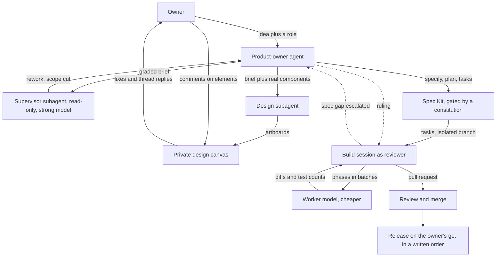

# You are not a coder any more, you are a system designer: first principles for building with agents

*October 2026.*

I build a consumer app on my own. Last week one feature went from a rambling message I typed to a feature running in production, and I wrote almost none of the code. This post is not about that app or how it is built. It is about the principles underneath the process, so you can apply them to whatever you are building.

Every section below starts from a first principle: something true about agents that does not depend on my stack, my app or this month's tools. Then what happened, then what to take away.

## Principle 1: An agent's output is bounded by the context it can see

Agents read whatever is lying around. Old branches, half-finished sessions and stale notes are all context, and they are wrong context.

**What happened.** Before starting, I had Claude check which old sessions and worktrees were still needed, and archive the rest.

**Takeaway.** Start every piece of work with a clean desk. It is the cheapest quality improvement there is, and it is the one people skip.

## Principle 2: A role changes what the model looks for, not just how it talks

"Write requirements for a feature" and "you are a product owner with deep domain expertise" produce different documents. The first describes screens. The second asks who could be harmed, what the evidence actually says, and what the product must never claim.

**What happened.** My opening prompt gave Claude a job title, not a task:

> "I want you to become product owner for upcoming feature we want to build..."

and then a line naming the specialist expertise I wanted it to bring, the way you would brief a senior hire.

It researched like a product owner. It graded every claim as established, moderate or preliminary. It wrote down the phrases the product must never use, because they overclaim. It noted where its own sources were thin, for instance that the expert interviews it found were summaries rather than transcripts.

**Takeaway.** Before you ask for an output, decide who should be producing it. Name the expertise. Then ask it to grade its own confidence and flag weak sources. You get a brief you can argue with, not a list of features.

## Principle 3: Ask what you can do that others structurally cannot

Copying a competitor gives you their product a year late. The useful question is what they cannot do because of how they are built.

**What happened.** I asked the agent to learn from a well-known competitor and innovate beyond it. It read reviews of a popular app in the space and came back with one sharp observation: that app sees one kind of data, and mine sees several. Its ideas all came from combining data a single-purpose app never has.

**Takeaway.** Point the agent at a competitor and ask for structural advantages, not features. The answer is usually your own data, your own users or your own constraints.

## Principle 4: The author cannot review their own work

The same model that wrote a plan shares its blind spots. A second agent with a different brief ("find what is wrong") and access to the real system will see what the author could not.

**What happened.** I said: "get this reviewed with your supervisor agent which is opus 5.5 as a subagent". The supervisor ran read-only against the brief and the codebase. Its verdict was **rework**.

Its main finding was the kind that kills features late: a third of the ideas depended on data the app does not actually record. The product-owner agent had assumed it. I had assumed it. The supervisor read the code and checked. Building those ideas would have meant showing users facts that were never captured.

It also found a safety check that one entry point could bypass, places where the product had drifted from presenting information into giving advice, and features that could harm a vulnerable user. It cut the scope to a smaller first version and moved the rest behind a separate piece of foundational work. That removed most of what I had just asked for. It was right.

**Takeaway.** Insert a reviewer before design, not after build. Give it a stronger model, read-only access, and the real code, not just the document. Expect it to cut scope, and let it.

## Principle 5: Decide where a feature lives before deciding what it looks like

A design agent with only a feature brief will design a new product. Mine did.

**What happened.** The first round of mocks was polished and wrong. It had invented its own header, its own navigation and its own components. None of it looked like my app. My reaction: what I see in the canvas "does not fit".

The fix was not better design. It was a different question asked first: how does this integrate? Where does setup live, where does daily use live, does it deserve a place in the navigation? We answered those in plain words. The answer was to reuse existing places and add no new top-level destination. Then the design agent redid every board, this time starting from the app's real component source and from earlier design canvases that already reproduced the app. 23 artboards came back inside the real shell, with a list of what still did not match.

**Takeaway.** Ground the design agent in reality: real components, real layout widths, an existing canvas of your product. And settle integration before screens, because integration is a product decision and screens are a consequence of it.

## Principle 6: Feedback anchored to the thing beats feedback about the thing

"Make the dashboard panel better" is ambiguous. A comment pinned to the exact element is not.

**What happened.** I reviewed the design canvas the way I would review a designer's file: comments on elements. Some of mine, verbatim:

- "can this be different prominent"
- "button color"
- "need different wheel"
- "did not like the border"

Each was fixed live and answered in its own thread. When a fix missed, I pushed back in the same thread ("is this indicating progress? I dont think so") and the next revision got it. Nine threads, about twelve minutes.

**Takeaway.** Use a review surface where feedback attaches to the artefact. You get precision, and you get a record of what changed and why.

## Principle 7: Delegation needs written rules, not trust

You cannot hand work to an agent and hope it shares your judgement. You can hand it rules it must check itself against.

**What happened.** My project has a short constitution: a handful of binding principles that every specification and plan is checked against. I used Spec Kit to go from brief to specification to plan to tasks, and each stage was gated by those principles. Where a principle needed interpretation, the plan recorded the call as a judgement, so a reviewer could disagree with it explicitly instead of discovering it later.

The output was a specification, a plan and 39 ordered tasks.

**Takeaway.** Write down the five to ten rules your product must never break, and make every stage check against them. A constitution turns "do it the way I would" into something an agent can actually verify.

## Principle 8: Your past mistakes are the most valuable thing you can give an agent

Every repository has traps that have bitten before. A fresh agent knows none of them.

**What happened.** The task list carried my scars as explicit instructions:

- Record the passing test count before any change, and finish with nothing that passed before now failing.
- Never test against real user data.
- Mutation-test every guard: break what it protects, watch the test fail, restore it. A guard that cannot fail is decoration.
- Avoid a specific tooling trap that had silently broken tests here before.
- House style rules, stated plainly.

**Takeaway.** Keep a list of every mistake that has cost you a session. Put the relevant ones into each task brief. That list is your real engineering culture.

## Principle 9: Put judgement where it is scarce and labour where it is cheap

A strong model writing routine code is wasted. A cheap model making architectural calls is dangerous.

**What happened.** A separate build session got the tasks in its own isolated branch and workspace. Just after it started, I changed its job: "can you make use of sonnet as coding agent and you the main agent can be reviewing?"

So the strong model became a reviewer. It handed phases to a cheaper worker model in batches, read every diff, and moved on only when the full test gate was green. The suite grew by about a hundred tests across the build, from a baseline of 1419 to 1525 after the third batch, with nothing previously passing broken. When the worker could not open the design canvas, the reviewer fetched what it needed and settled conflicts with the spec.

**Takeaway.** Orchestrate. Strong model for review and rulings, cheaper model for well-specified implementation, isolation so the work cannot damage anything else.

## Principle 10: An agent that can escalate does not have to invent

When a specification has a gap, an agent will fill it. Usually with something plausible. The question is whether it fills it silently.

**What happened.** The build session found that the spec promised something the data model could not support. It wrote up the two options, recommended one, and sent the question up to the session that wrote the spec. The ruling came back in the same minute and went into the current batch.

**Takeaway.** Give every builder a channel upward and make "ask" cheaper than "guess". Then decide quickly, because a fast answer is what keeps escalation worth doing.

## Principle 11: The human keeps the irreversible steps

The build session opened a PR that listed every task, the test counts before and after, every mutation test and its result, the spec correction, and what it had not verified.

Before anything merged, I asked it one question: "did you review your subagent's work?" It answered honestly. The later phases had got lighter checks than the early ones, and it had taken the mutation results on the worker's word. So I made it tech lead: review properly, merge, and take it to production. The real review found two defects every test had passed, and both were fixed before the merge.

Then it released, on my explicit instruction, in an order written down long before:
1. Check that production was in the expected shape.
2. Rehearse the database change locally.
3. Apply the database change and the access rules in one transaction, before any code.
4. Merge and deploy.
5. Probe production.

Production served the new interface, an end-to-end connection check passed 11 of 11, and every affected screen rendered signed in. Unit and integration tests went from 1,419 to 1,532, and end-to-end from 107 to 109. The feature stays off for me until I turn it on. One loose end is honest to mention: the CI dependency scan went red on the main branch that day, from new third-party advisories unrelated to this feature.

**Takeaway.** Agents can propose, build, review and even execute a release. The human keeps the decision to ship, the order is written down before it's needed, and production is probed afterwards. Ask your reviewer agent whether it really reviewed.

## What went wrong and what it taught me

**The first mocks did not look like my app.** The design agent had a brief about a feature and nothing about the product it lived in. Lesson: grounding comes before creativity.

**Nobody checked whether the data existed.** I asked for features that needed information the app never records. Neither I nor the product-owner agent noticed. The supervisor did, by reading the code rather than the brief. Lesson: a reviewer with access to the real system catches what a reviewer of documents cannot.

**The spec missed one half of an operation.** Every write in my app must be safe to retry. The spec covered retrying the start of an action but not its end, so a retried "end" would have been refused instead of returning the same result. No duplicate data, but not what the contract promised. I signed off that spec, so this one is on me. Lesson: when reviewing a data model, walk every operation's retry path, start and finish.

**A style rule slipped through.** I do not allow em dashes anywhere. The rule was in every brief the worker got, and one still landed in a test. The reviewing session caught it. Lesson: a rule in prose is a request. A rule enforced by a review step or a test is a rule.

**The reviewer started rubber-stamping.** As the build went on, the reviewing agent checked less and trusted the worker more. One direct question from me turned that back into a real review, and the real review found two defects. Lesson: review fatigue happens to agents too, so ask.

**Smaller ones.** The design agent could not render its own canvas to check it, and the worker model could not open the canvas at all. One test run failed because my laptop slept for 13.6 hours and dropped a database connection, which looked like a real bug until someone read the error.

## The flow

## The playbook

1. **Clean the desk** so agents do not read stale context.
2. **Assign a role with named expertise**, not a task.
3. **Make research grade its confidence** and say where its sources are thin.
4. **Ask for structural advantages** over competitors, not their features.
5. **Review before design** with a separate, stronger, read-only agent that can see the real system. Let it cut scope.
6. **Decide integration before screens.**
7. **Ground the design agent** in your real components and an existing canvas of your product.
8. **Review designs with anchored comments**, and push back in the thread.
9. **Write a short constitution** and gate every stage on it. Record judgement calls where a reviewer can see them.
10. **Put your scars into every task brief**: baseline tests, no real data, mutation-tested guards, known traps.
11. **Orchestrate**: strong model reviews, cheaper model builds, in isolation.
12. **Make escalation cheap** and answer it fast.
13. **Keep the decision to ship with a human**, and the release order written down.

None of these depend on the app I am building. They depend on one shift: you stop being the person who writes the code, and become the person who designs the system that does.
