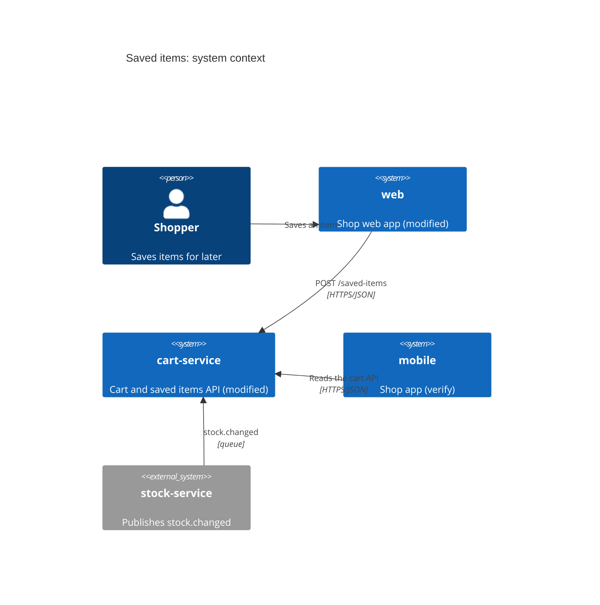

# Architecture overview: <feature>

<!-- Stage 3 Design, work across repos. Owner: architect agent. Gate: with plan.md; Build checks the table against tasks.md.
     Write it before tasks.md when the tasks touch more than one repo or system; one repo needs none (its
     Level 1 view goes in plan.md "## C4 views" when the context changes). Design refuses a change type
     outside the four below. Build refuses a repo that a task names in its repos list with no row here,
     and a new or modified row that no task changes.
     The table is read by cell position:
     - System / repo: the repo name exactly as tasks.md writes it. Backticks are fine; "Web app" does not
       match the repo web.
     - Change type: exactly one of new, modified, config-only, or consumer-only (verify) for a system that
       does not change but depends on a changed contract, so it is still checked.
     - Owner: the team or person who approves that repo's PR.
     - Contract impact, Data impact: name the thing, or "none".
     - Deploy order: a bare number (1 goes first) or n/a. Any text after the number breaks the order.
     - Keep one table in the section and no other line that starts with "|".
     Tie each impact to its source (openapi.yaml, db-design.md, file:line); end one you could not check
     with [unconfirmed]. Levels 2 and 3 of C4 belong in plan.md, not here. -->

## System context

<!-- C4 Level 1, required by this process, not checked by the gate: the people and systems around this
     change, as Mermaid. One element per row of the table below, named exactly as in the table, plus the
     people and external systems they talk to. Mark each row's system "(new)", "(modified)",
     "(config-only)" or "(verify)". Example:

-->

## Systems under change

| System / repo | Change type | Owner | Contract impact | Data impact | Deploy order |
|---|---|---|---|---|---|
| `<repo>` | <new, modified, config-only or consumer-only (verify)> | <team> | <what changes, or none> | <what changes, or none> | <1, 2, ... or n/a> |

<!-- Example:
| `cart-service` | modified | cart team | adds POST and GET /saved-items (openapi.yaml v1.5.0) | adds saved_items (db-design.md) | 1 |
| `web` | modified | web team | calls POST and GET /saved-items | none | 2 |
| `mobile` | consumer-only (verify) | app team | reads the cart API, unchanged | none | n/a |
-->

## Between deploys

<!-- One line per deploy step: what still works if the next step is late, and what rolling this step back
     does. No step may need a later one to be safe: a consumer never ships before the contract it calls,
     and nothing is removed while a deployed consumer still uses it. Example:
- After 1, before 2: /saved-items is live and unused; web is unchanged. Rolling back 1 removes the routes, which nothing calls yet.
- After 2: web shows the save button. Rolling back 2 hides it; 1 stays.
     Or: None, because every system here ships in one release. -->
