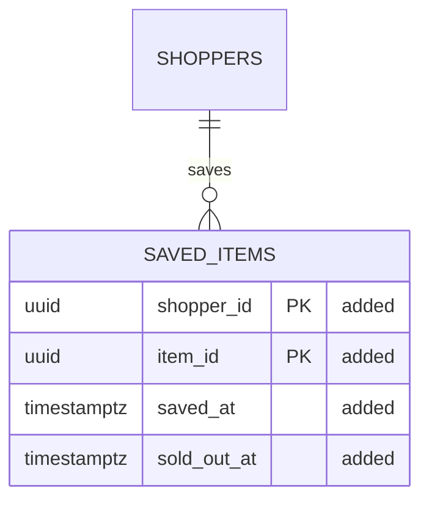

# DB design: <feature>

<!-- Data work only (kind data), light and full lanes. Owner: dba agent. Gate: a human DBA with the gate of each stage below, asked with "sdlc ask <feature>".
     The data contract, as openapi.yaml is the API contract: it shows the DELTA (what this change adds,
     alters or drops), not the whole schema. Each section is due at a gate, so fill them in order:
     - Plan: Data impact.
     - Design (full lane) or Build (light lane): Data model, Migration plan (expand-contract).
     - Build: Rehearsal, Down migration.  - Release: Backout.
     A section with only a comment in it is empty, and the gate refuses it. Keep every "## " heading
     exactly as written; never start a line with "# " or "## ", even inside a code block.
     Or: None, because <a reason about this change>, where a section does not apply.
     Tie every claim to its source (a migration file, file:line, a fact F3, a query plan, a measured row
     count); end a number you did not measure with [unconfirmed]. -->

## Data impact

<!-- One row per table this change reads or writes, rows and growth measured. "Scoped by" is the column every
     query filters on and what enforces it. Then one line each for personal data and retention. Example:

| Table | Change | Rows today | Growth | Read by | Scoped by |
|---|---|---|---|---|---|
| shoppers | reads | 2.1 M (F1) | 3 k a day | cart-api | shopper id from the session |
| saved_items | new | 0 | at most 200 per shopper [unconfirmed] | cart-api, stock-listener | shopper id from the session |

Personal data: none new; saved_items holds a shopper id and an item id.
Retention: 90 days (prd.md Q2); deleted with the shopper account (src/accounts/erase.ts:88). -->

## Data model

<!-- The delta as a Mermaid erDiagram, linted at the gate:
     - The "%% changed:" line names every entity this change adds, alters or drops.
     - Draw each of those with its attributes, and the neighbours they relate to (no attributes needed).
     - Mark each changed column with an attribute comment: "added", "altered: <from> to <to>" or
       "dropped". A new table has every column "added". Unmarked columns are unchanged context.
     Example:

-->

## Migration plan (expand-contract)

<!-- One row per step, in order: expand, write both, backfill in batches, switch reads, then contract in a
     later release once nothing reads the old shape. For each step: the release that ships it, the lock it
     takes and for how long on today's volume, and how to undo it. No long lock on a busy table. A step
     that cannot be undone (a drop, a lossy type change) says so and names its point of no return. Example:

| Step | Release | What runs | Lock and time | Undo |
|---|---|---|---|---|
| 1 expand | v1.5.0 | migrations/0042_saved_items.sql: create saved_items | none on existing tables | 0042_down.sql drops it |
| 2 switch | v1.5.0 | flag SAVED_ITEMS on | none | flag off |
| 3 contract | none | nothing to remove | none | none |
-->

## Rehearsal

<!-- Where each migration and its down ran, on what data, how long, and what it locked. Synthetic or
     masked data at production volume, never real personal data. Example:
Ran 0042 up and down on staging-copy (2.1 M shoppers, masked, 2026-11-02): up 0.3 s, down 0.2 s. pg_locks
showed no wait over 50 ms on shoppers. Log: specs/saved-items/rehearsal.log. -->

## Down migration

<!-- Each migration's down, and the data it cannot bring back. Example:
- migrations/0042_down.sql drops saved_items. Loses: every saved item since release; shoppers save again. -->

## Backout

<!-- For Release: the order in production if it goes wrong, who runs it (always a person), and the restore
     point taken before step 1. Data ships before the code that needs it and is removed only after nothing
     reads it. Example:
1. Turn SAVED_ITEMS off (on-call, seconds).
2. Roll cart-service back to v1.4.0.
3. Run 0042_down.sql only if the table itself is at fault (human DBA).
Restore point: snapshot cart-prod-2026-11-10 before step 1. -->
