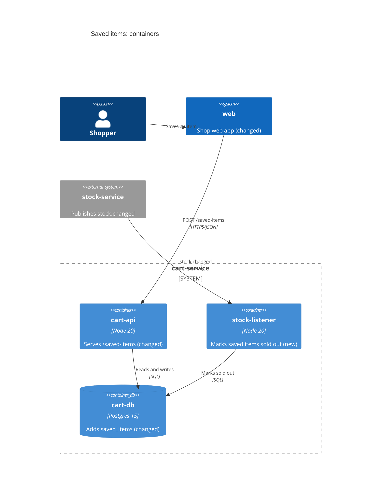

# Design: <feature>

<!-- Design, full lane only. Owner: architect agent. Gate: the architect and product lead, asked with "sdlc ask <feature>"; under autonomy it passes on its checks.
     A required section with only a comment in it is empty, and the gate refuses it. Keep every "## " heading
     exactly as written; never start a line with "# " or "## ", even inside a code block.
     Or: None, because <a reason about this change>, where a section does not apply.
     Tie every claim to its source (file:line, a fact F3, an R or AC id, an ADR); end one you could not
     check with [unconfirmed]. Link other documents; do not copy them. A line true of any feature: delete it. -->

## Summary

<!-- For the approver, who reads this first. Five lines, then one row per requirement the design
     touches (the example shows four of seven); a requirement the design must change with no row has no design. Example:
Builds: a saved list per signed-in shopper, marked sold out from stock events.
Reuses: cart-service and its Postgres database; adds one listener, no new service.
Biggest risk: a missed stock.changed event leaves a sold-out item shown as available (see Error handling).
Not doing: a separate lists service (ADR-0012); product scope is in prd.md "## Out of scope".
Open: none (or each open question, with who answers it).
| Requirement | Where it is built |
|---|---|
| R1 save an in-stock item | cart-service (cart-api), src/lists/save.ts |
| R2 sold-out mark within 5 min | cart-service (stock-listener), src/stock/events.ts |
| R3 whole list in under half a second | cart-db index on shopper id, src/lists/repo.ts |
| R4 refuse a 201st item | cart-api, src/lists/save.ts |
-->

## C4 views

<!-- Mermaid C4 of only what this change adds or alters and its neighbours, changed elements marked "(new)"
     or "(changed)". docs/architecture/workspace.dsl stays the whole model: update it when a container changes.
     - Level 1, System context: in architecture-overview.md for work across repos. One repo: draw it here only
       when the context changes (a new person or external system), else "Level 1: unchanged (workspace.dsl)".
     - Level 2, Container: required when a container (app, service, database, queue) is added or changed.
     - Level 3, Component: only when a component is added, removed or rewired (a new module boundary or
       consumer), not for edits inside one. Most changes need none.
     - No Level 4 (code). Where ordering, retries or concurrency decide correctness, draw a sequenceDiagram.
     Example:

     Or: None, because no container or component changes (say which one the code lives in). -->

## Decisions

<!-- One line per ADR this change writes, from docs/adr/0000-template.md: one for each new datastore,
     dependency, service or breaking contract. Every ADR id here is checked at the gate (see the ADR
     template), so name ADRs you only follow or replace inside your ADR, not here. Example:
- ADR-0012: saved lists live in the cart database, not a new service.
     Or: None, because it adds no datastore, dependency, service or breaking contract. -->

## Data model

<!-- Data work: one line, "See db-design.md." Do not copy the diagram here. Any other change:
     None, because no table, column or stored field changes. -->

## Contracts

<!-- Every interface another system relies on that this change adds or alters (HTTP in openapi.yaml from
     "sdlc api <feature>", events, files, CLI flags): what, version before and after, Additive or Breaking.
     The gate diffs openapi.yaml with the base branch: a removed operation or response code needs a
     "Breaking" line naming the method and path exactly as openapi.yaml has them. Example:
- Additive: POST /saved-items and GET /saved-items; cart API v1.4.0 to v1.5.0.
- Breaking: DELETE /saved-items/{itemId} is removed; v1.5.0 to v2.0.0. Clients move to POST /saved-items/{itemId}/remove; web moves in T3.
     Or: None, because no interface outside this repo changes. -->

## Threat model

<!-- One row per way this change could be abused or go wrong, what stops it, and the test or check that
     proves it. On auth, payments or personal data the safe-ai-sdlc-expert writes the rows. Example:
| Threat | What stops it | Proved by |
|---|---|---|
| A shopper reads another's list | the shopper comes from the session; no id in the path | tests/lists/api.test.ts "another shopper's list is 404" |
| A double click saves twice | unique key on (shopper, item) | AC-2 |
     Or: None, because it adds no input, stored data or permission. -->

## Error handling

<!-- One line per failure: what the caller gets, what is retried (how often, then what), what the user sees. Example:
- stock.changed delivery fails: the queue redelivers 5 times over 10 min, then dead-letters and alerts; the item shows as available until then.
- POST /saved-items with no session: 401, body {"code": "unauthenticated"}. -->

## Data and tenancy

<!-- Whose data it reads and writes, the key every query is scoped by and where that key comes from, and
     the test that proves one owner cannot reach another's data. Tables, row counts and retention are in
     db-design.md "## Data impact". Example:
Reads and writes the signed-in shopper's saved items only. Every query filters by the shopper id from the
session, never from the request; tests/lists/api.test.ts "another shopper's list is 404" proves it. -->

## Test plan

<!-- Which level proves each acceptance scenario, where its data comes from (synthetic only, isolated and
     torn down), and the budgets. See templates/testing/README.md. Example:
- AC-1: api, Postgres in a container, seeded per test and rolled back.
- AC-2: unit, factories.ts. AC-3: e2e, one synthetic shopper and item.
- Budget: GET /saved-items p95 under 500 ms for 200 items at 50 requests a second (R3). -->

## Run it

<!-- What on-call needs on day one. One line each, or "None, because ..." for a line that does not apply. Example:
- Signals: log event saved_item.marked_sold_out; metric stock_listener_dead_letters_total.
- Alert: any dead letter in 10 min pages cart on-call; runbook docs/runbooks/saved-items.md.
- Config and secrets: flag SAVED_ITEMS, off by default; no new secret.
- Cost and backup: one table, under 1 GB a year, inside the cart database backup. -->

<!-- Only when they apply: "## Changes since v1" (the gate needs it once this plan was approved: what changed
     and the change request behind it; v2 after two approvals), "## Screens" and "## Accessibility checks" (UI). -->
