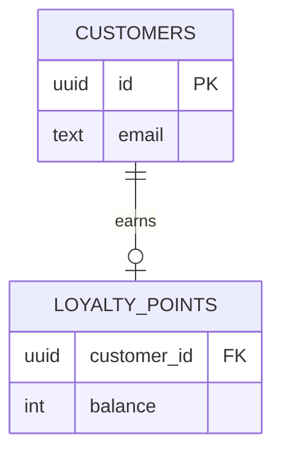

# Plan: <feature>

<!-- Stage 3 Design. Gate: architect and product lead; "sdlc approve <feature> 3". Write "None, because ..." where a section does not apply. -->

## Data model

<!-- For data work (--kind data) the gate requires a Mermaid ER diagram; GitHub, Confluence and VS Code
     render it. Draw every entity this change touches with its attributes, and name the new or changed
     ones on a "%% changed:" line:

-->

## Contracts

<!-- Versioned. For API work (--kind api) the contract is specs/<feature>/openapi.yaml, started and
     checked with "sdlc api <feature>", which also puts swagger.html beside it to view it in Swagger UI.
     Any breaking change against the base branch (a removed operation or response) must be declared here
     with the word "breaking", the operation, the version bump and how clients migrate. Breaking changes
     also need an ADR. -->

## Decisions

<!-- Links to ADRs in docs/adr/, and every judgement made interpreting the constitution. -->

## C4 changes

<!-- New, changed and removed elements in docs/architecture/workspace.dsl. -->

## Screens

<!-- Mocks from real components, the canvas link, and comment threads all resolved by a human. -->

## Unmatched components

## Accessibility checks

<!-- WCAG 2.2 AA checks QA will automate. -->

## Microcopy

## Test strategy

<!-- Levels, synthetic data, performance and accessibility budgets. -->

## Test data

<!-- Per level: where data comes from (factories, API seeding, fixtures), how each test isolates it
     (unique values, a rolled-back transaction, its own schema or tenant), how it is torn down (also on
     failure), and the dataCheckCommand that proves nothing was left behind. Synthetic data only.
     See the plugin's templates/testing/README.md. -->

## Observability

<!-- Logs, golden signals, traces, SLO alerts each with a runbook link. -->

## Operability

<!-- Environments touched, IaC modules, secrets needed (by name), cost delta, backup and restore. -->
