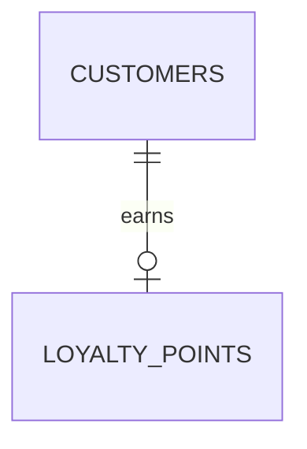

# Plan: <feature>

<!-- Stage 3 Design, full lane only. Gate: architect and product lead, asked with "sdlc ask <feature>"; under autonomy it passes on its checks.
     Write "None, because ..." where a section does not apply. -->

## Decisions

<!-- Links to ADRs in docs/adr/. Each ADR names two options and records its review in "## Review".
     A change that adds a datastore, dependency or service needs one. -->

## Data model

<!-- For data work, a Mermaid ER diagram of every entity the change touches (advice, not a gate):

-->

## Contracts

<!-- Versioned. For API work the contract is specs/<feature>/openapi.yaml ("sdlc api <feature>" also
     writes swagger.html beside it). A breaking change against the base branch must be declared here with
     the word "breaking", the operation, the version bump and how clients migrate. -->

## Threat model

<!-- What an attacker or a mistake could do through this change, and what stops it. -->

## Test plan

<!-- Levels, test data (where it comes from, how it is isolated and torn down; synthetic only), and
     performance or accessibility budgets. See templates/testing/README.md. -->

## Run it

<!-- Logs, signals and alerts with runbook links; environments, secrets by name, cost delta, backup. -->

<!-- Optional, when they apply: ## C4 changes (a new container), ## Screens and ## Accessibility checks
     (UI changes). -->
