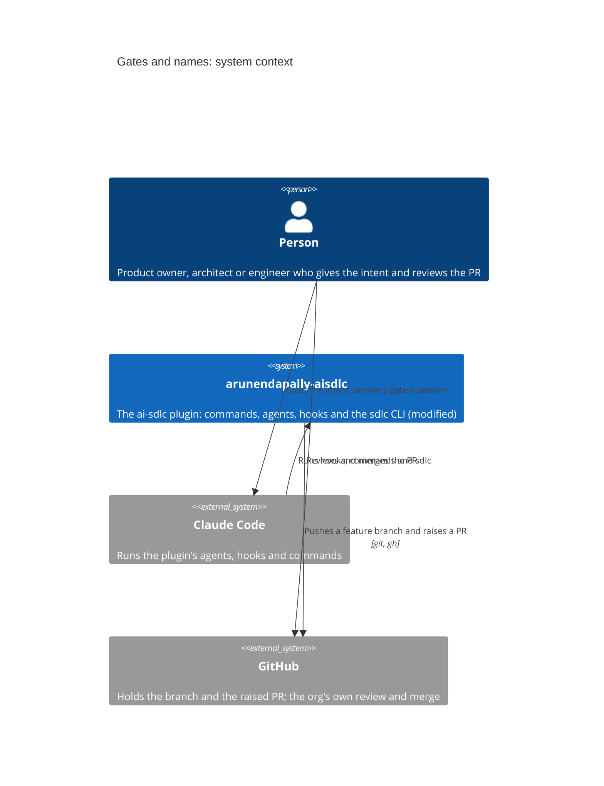

# Architecture overview: gates-and-names

## System context

## Systems under change

| System / repo | Change type | Owner | Contract impact | Data impact | Deploy order |
|---|---|---|---|---|---|
| `arunendapally-aisdlc` | modified | Arun Endapally (plugin owner) | sdlc CLI messages, templates and gate checks | specs/<feature>/state.json, unchanged shape | n/a |

## Between deploys

None, because every system here ships in one release.

## Decision log

| Date | Decision | Agreed by | Source | Changes |
|---|---|---|---|---|
| 2026-11-06 | The plugin's work stops at a raised PR from a branch; approval, merge and release are the org's | Arun Endapally (plugin owner) | specs/stop-at-pr/prd.md Q1, "Only make sure the AI agent uses a branch rather than main and always raises a PR" | stop-at-pr R1 to R5; ADR-0008 |
| 2026-11-06 | Stages have names (Define, Design, Build, Verify), each with an input, a processing and an output | Arun Endapally (plugin owner) | specs/stage-names/prd.md Q1, "each stage should have a name, an input, a processing and an output" | stage-names R1 to R5 |
| 2026-11-07 | The decision log lives in the capability's architecture overview, not per feature, and the PRD stays as signed | Arun Endapally (plugin owner) | specs/capability-overview/prd.md Q1, "move it to the architecture overview. Keep the PRD immutable" | capability-overview R1, R4 |
| 2026-11-07 | Each stage ends with a Definition of done, and a stage's Definition of ready is the previous stage's Definition of done | unconfirmed | Claude Code session, relayed by the lead agent; no verbatim quote on record | definition-of-done slice |
| 2026-11-07 | The decision log records what was agreed; ADRs record how it is built | unconfirmed | Claude Code session, relayed by the lead agent; no verbatim quote on record | capability-overview R4 |
| 2026-11-07 | Once Build has started, a spec change asks once: change request or amendment, with why a change request is often better and how the effort changes | unconfirmed | Claude Code session, relayed by the lead agent; no verbatim quote on record | change-request slice |
| 2026-11-07 | Teams are small, three people by default | unconfirmed | Claude Code session, relayed by the lead agent; no verbatim quote on record | gates-and-names Outcome |
